# Embedded-Security-Attack

## Requirements *(Hardware necessary to conduct your attack, as well as schematics describing their interfacing)*
- Computer
- 2 Arduinos (target & controller)
- Breadboard & wires
- Optionnal : 100k, 10k resistors & small ceramic capacitor
- Oscilloscope

## The Target *(Asset description)*
The target is an Arduino Uno board powered by the ATmega328P 8-bit AVR microcontroller.
The firmware implements an interactive command-line interface over UART (Serial) prompting users for a password. Upon successful validation, it computes and outputs a cryptographic hash of the secret keyphrase along with its associated salt.

## Attack Tree — ATmega328P (Arduino Uno) — Timing Attack

```mermaid
graph TD
    ROOT["Root goal<br/>Obtain the Hash + Salt<br/>stored in the ATmega328P"]
 
    ROOT --> A["A. Direct extraction<br/>of flash/EEPROM memory"]
    ROOT --> B["B. Exploiting the<br/>'password' serial interface"]
 
    %% ---------- BRANCH A ----------
    A --> A1["A1. Read via ISP (SPI)"]
    A1 --> A1cond{{"AND"}}
    A1cond --> A1a["Lock bits fuses = 0<br/>(flash unprotected)"]
    A1cond --> A1b["Access to<br/>MOSI/MISO/SCK/RESET pins"]
 
    A --> A2["A2. Bypassing<br/>lock bits"]
    A2 --> A2a["Partial chip erase /<br/>glitch during erase"]
    A2 --> A2b["Decapping + optical/<br/>microprobe reading (invasive)"]
 
    A --> A3["A3. Is debugWIRE active?"]
    A3 --> A3cond{{"AND"}}
    A3cond --> A3a["DWEN fuse = enabled"]
    A3cond --> A3b["debugWIRE adapter<br/>on RESET pin"]
    A3cond --> A3out["-> Memory dump +<br/>hardware single-step"]
 
    %% ---------- BRANCH B ----------
    B --> B1["B1. Naive brute force<br/>(all combinations)"]
    B1 --> B1note["Impractical alone:<br/>key space too large"]
 
    B --> B2["B2. Timing attack via<br/>manual clock control"]
 
    B --> B3["B3. Power analysis<br/>(SPA/DPA) during comparison"]
 
    B --> B4["B4. Fault injection<br/>(clock/voltage glitch)<br/>to skip verification"]
 
    %% ---------- DETAIL OF THE CHOSEN BRANCH B2 ----------
    B2 --> B2_1["B2.1 Protocol reconnaissance<br/>(baud rate, frame, messages)"]
 
    B2 --> B2_2["B2.2 Replacing the clock<br/>with a controllable external source"]
    B2_2 --> B2_2cond{{"AND"}}
    B2_2cond --> B2_2a["Stable external clock<br/>(generator/companion MCU)"]
    B2_2cond --> B2_2b["Stable power supply/reset<br/>at startup"]
 
    B2 --> B2_3["B2.3 Counting clock cycles<br/>(single-step or timing measurement)"]
 
    B2 --> B2_4["B2.4 Timing oracle<br/>character by character"]
    B2_4 --> B2_4a["Hypothesis: sequential<br/>comparison is not constant-time"]
    B2_4 --> B2_4b["For each position:<br/>test candidate values,<br/>keep the one with most cycles"]
    B2_4 --> B2_4c["Repeat position by position<br/>until the full password is recovered"]
 
    B2 --> B2_5["B2.5 Measurement reliability"]
    B2_5 --> B2_5a["Average/median over<br/>multiple trials per candidate"]
    B2_5 --> B2_5b["Control temperature/<br/>supply voltage"]
 
    B2 --> B2_6["B2.6 Final validation"]
    B2_6 --> B2_6out["-> Send the reconstructed password<br/>-> Receive Hash + Salt"]
 
    %% ---------- STYLES ----------
    classDef chosen fill:#2e7d32,stroke:#1b5e20,color:#fff,stroke-width:2px;
    classDef cond fill:#fff3cd,stroke:#997404,color:#000;
    classDef root fill:#1565c0,stroke:#0d47a1,color:#fff,stroke-width:2px;
 
    class ROOT root;
    class B2,B2_1,B2_2,B2_3,B2_4,B2_5,B2_6,B2_6out,B2_4a,B2_4b,B2_4c,B2_5a,B2_5b,B2_2a,B2_2b chosen;
    class A1cond,A3cond,B2_2cond cond;
```
 


## Vulnerability severity assessment
### CVSS v4.0 Score: 4.1 / Medium
- Macro vector: 211200
- Exploitability: Low
- Complexity: Low
- Vulnerable system: Medium
- Subsequent system: Low
- Exploitation: High
- Security requirements: High


We take the hypothesis that the target use "strcmp" or similar method to verify the password.
So it should be vulnerable to a timing attack.

## Attack Demonstration *(Attack(s) description and implementation)*

We received an Arduino Uno board, and the goal was to break into it in order to recover a hash and a salt. We were also given the compiled firmware to flash onto the Arduino.

Before tackling the hardware itself, we did some preliminary research on the firmware we’d been given. By searching for all the strings present in the code (for example using the site https://sisik.eu/elf), 
we were able to extract the libraries used as well as several lines of text used somewhere in the program (here are a few examples):

```
f7-@Jp0w
Welcome to the vault. This is not the main entrance.
No input. Enter password:
Je suis une petite tortue
Here is your salt:
Here is your hash:
>> ACCESS GRANTED: running protected section
>> ACCESS DENIED
```

(see the full file in “dump.txt”)

We then moved on to the physical attack on the Arduino.

We first tried to get into the Arduino through its serial communication port, the default method of communication between a computer and an Arduino. A welcome message read: “Welcome to the vault. This is not the main entrance.”

We then decided to desolder the ATmega328p from the Arduino board and place it on a breadboard, so we could access all the pins more comfortably. We restarted the ATmega repeatedly, each time measuring a different pin with the logic analyzer or oscilloscope. Using this technique, we found that pins 10 and 11 were also used for a serial communication line.

When we tried connecting to it, the message this time was: “Enter password:”

That was very encouraging. From this point on, we could start thinking about a specific attack method.

I decided to go with a timing attack, but with a twist. Instead of simply measuring elapsed time — which would be too imprecise — I planned to control the ATmega’s internal clock so I could precisely count the clock cycles needed to verify the password. Our working hypothesis was that the password check was done character by character using “strcmp” or a similar method with early-exit behavior.

After some research, it turned out the ATmega isn’t designed to run off an external clock unless it’s reprogrammed and specifically configured to do so. In my case, however, I couldn’t reprogram it since I didn’t have the source code, and in its current state it was set up to run off a quartz crystal.


Still, I decided to try anyway. The ATmega datasheet tells us that the quartz clock circuit uses the OSC1 and OSC2 pins. So I used the oscilloscope to measure the input and output of the crystal to get a sense of the voltage and frequency ranges. We estimated the crystal clock circuit runs at around 16 MHz, with a voltage of about 700 mV peak-to-peak centered around 500 mV.


I planned to use a second Arduino board to simulate a clock signal and handle the communication. I used a 100k–10k voltage divider followed by a decoupling capacitor to step down the voltage from a pin on the “controller” Arduino, then fed that signal into the OSC1 input of the target ATmega to drive its clock.

As a first test, to see whether the technique would even work, I flashed a blank ATmega with a simple blink program (LED blinking on and off).

To generate the clock signal, I used an Arduino interrupt timer. After running through some calculations (see clock_frequency_calculation.txt), 50 kHz seemed like a good compromise: going faster would have caused issues on the controller Arduino’s side, since it struggled to generate interrupts at a higher rate; going slower would have been far too slow for serial communication with the target ATmega.

Going from the crystal’s 16 MHz down to the 50 kHz generated by the controller Arduino, we’d expect the blink program to run at 0.3125% of its normal speed — in other words, 320 times slower.

And despite everything I read online telling me this wouldn’t work and that I shouldn’t bother, it actually worked! In fact, it turned out to still work even after disconnecting the voltage divider entirely, with no physical electrical contact between the wires at all (likely due to inductive coupling or some similar phenomenon).

With the proof of concept validated, I was able to reflash the ATmega with the provided firmware to carry out the attack.

There was, however, a subtlety: now that the ATmega was only running at 50 kHz, it still “thought” it was communicating at 9600 baud, but it was actually communicating 320 times slower — so really at 30 baud. I therefore needed to write code for the controller Arduino that would bridge the USB communication (at 9600 or 115200 baud) down to the target ATmega’s 30 baud, in both directions (transmit and receive).

I first tried using the Arduino SoftwareSerial library, but it doesn’t handle such low baud rates well. So I wrote my own code using manual serial bit-banging, handling the serial communication “by hand” using arbitrary pins. I also used the oscilloscope to precisely analyze the timing and delays of the UART frames, so I could sync as closely as possible with the target ATmega’s timing (see diagram).

This method works, but it turned out to be very unstable and extremely sensitive to ambient electromagnetic noise. Depending on location, positioning, or even the time of day, we could get 10 successful reads in a row — or nothing but unreadable noise.

## Counter Measures
