# Embedded-Security-Attack

## Requirements *(Hardware necessary to conduct your attack, as well as schematics describing their interfacing)*
- Computer
- 2 Arduinos (target & controller)
- Breadboard & wires
- Optionnal : 100k, 10k resistors & small ceramic capacitor
- Oscilloscope

## The Target *(Asset description)*
The target is an Arduino Uno board powered by the ATmega328P 8-bit AVR microcontroller.
The firmware implements an interactive command-line interface over UART (Serial) prompting users for a password. Upon successful validation, it computes and outputs a cryptographic hash of the secret keyphrase along with its associated salt.

# Attack Tree — ATmega328P (Arduino Uno) — Timing Attack *(Attack tree)*

```mermaid
graph TD
    ROOT["Objectif racine<br/>Obtenir le Hash + Salt<br/>stockes dans l'ATmega328P"]

    ROOT --> A["A. Extraction directe<br/>de la memoire flash/EEPROM"]
    ROOT --> B["B. Exploitation de l'interface<br/>serie 'mot de passe'"]

    %% ---------- BRANCHE A ----------
    A --> A1["A1. Lecture via ISP (SPI)"]
    A1 --> A1cond{{"ET"}}
    A1cond --> A1a["Fuses de lock bits = 0<br/>(flash non protegee)"]
    A1cond --> A1b["Acces aux pins<br/>MOSI/MISO/SCK/RESET"]

    A --> A2["A2. Contournement<br/>des lock bits"]
    A2 --> A2a["Chip erase partiel /<br/>glitch pendant l'effacement"]
    A2 --> A2b["Decapsulation + lecture<br/>optique/microsonde (invasif)"]

    A --> A3["A3. debugWIRE actif ?"]
    A3 --> A3cond{{"ET"}}
    A3cond --> A3a["Fuse DWEN = active"]
    A3cond --> A3b["Adaptateur debugWIRE<br/>sur pin RESET"]
    A3cond --> A3out["-> Dump memoire +<br/>single-step materiel"]

    %% ---------- BRANCHE B ----------
    B --> B1["B1. Brute force naif<br/>(toutes combinaisons)"]
    B1 --> B1note["Impraticable seul :<br/>espace de cles trop grand"]

    B --> B2["B2. Timing attack via<br/>controle manuel de l'horloge"]

    B --> B3["B3. Analyse de consommation<br/>(SPA/DPA) pendant comparaison"]

    B --> B4["B4. Fault injection<br/>(clock/voltage glitch)<br/>pour sauter la verification"]

    %% ---------- DETAIL DE LA BRANCHE CHOISIE B2 ----------
    B2 --> B2_1["B2.1 Reconnaissance du protocole<br/>(baudrate, trame, messages)"]

    B2 --> B2_2["B2.2 Remplacement de l'horloge<br/>par source externe pilotable"]
    B2_2 --> B2_2cond{{"ET"}}
    B2_2cond --> B2_2a["Horloge externe stable<br/>(generateur/MCU annexe)"]
    B2_2cond --> B2_2b["Alimentation/reset<br/>stables au demarrage"]

    B2 --> B2_3["B2.3 Comptage des cycles d'horloge<br/>(single-step ou mesure temporelle)"]

    B2 --> B2_4["B2.4 Oracle de timing<br/>caractere par caractere"]
    B2_4 --> B2_4a["Hypothese : comparaison<br/>sequentielle non constant-time"]
    B2_4 --> B2_4b["Pour chaque position :<br/>tester les valeurs candidates,<br/>garder la plus longue en cycles"]
    B2_4 --> B2_4c["Repeter position par position<br/>jusqu'au mot de passe complet"]

    B2 --> B2_5["B2.5 Fiabilisation des mesures"]
    B2_5 --> B2_5a["Moyenne/mediane sur<br/>plusieurs essais par candidat"]
    B2_5 --> B2_5b["Controle temperature/<br/>tension d'alimentation"]

    B2 --> B2_6["B2.6 Validation finale"]
    B2_6 --> B2_6out["-> Envoi du mot de passe reconstruit<br/>-> Reception Hash + Salt"]

    %% ---------- STYLES ----------
    classDef chosen fill:#2e7d32,stroke:#1b5e20,color:#fff,stroke-width:2px;
    classDef cond fill:#fff3cd,stroke:#997404,color:#000;
    classDef root fill:#1565c0,stroke:#0d47a1,color:#fff,stroke-width:2px;

    class ROOT root;
    class B2,B2_1,B2_2,B2_3,B2_4,B2_5,B2_6,B2_6out,B2_4a,B2_4b,B2_4c,B2_5a,B2_5b,B2_2a,B2_2b chosen;
    class A1cond,A3cond,B2_2cond cond;
```

(Vulnerability severity assessment)

(Attack(s) description and implementation)

(Proposed counter-measure(s))
